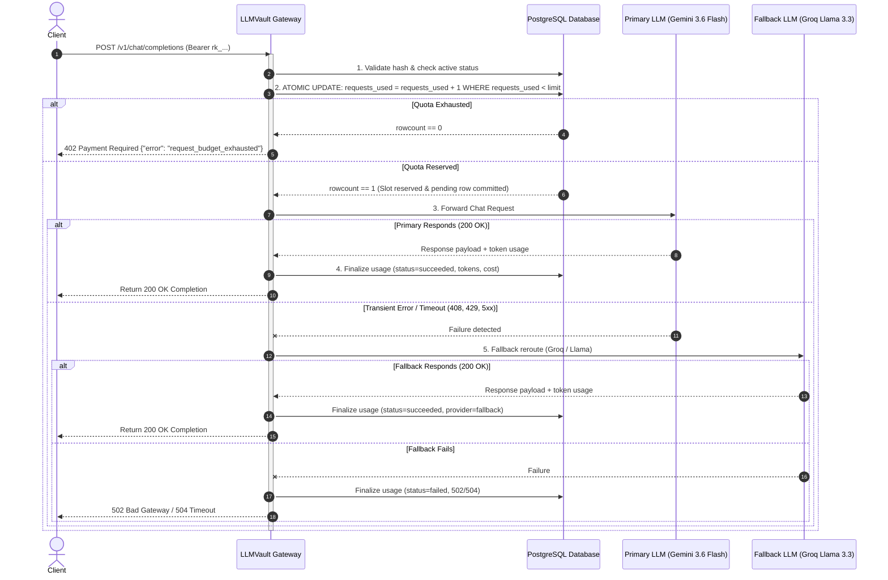

<div align="center">

# ⚡ LLMVault

### Production-Grade Minimal LLM Gateway & Budget Controller

[](https://www.python.org/)
[](https://fastapi.tiangolo.com/)
[](https://www.postgresql.org/)
[](https://llmvault-production.up.railway.app)
[](LICENSE)

**A secure, high-throughput proxy layer sitting between client applications and OpenAI-compatible LLM providers.**  
Enforces strict per-key request quotas, provisions hashed virtual API credentials, audits token consumption & estimated USD expenditure in PostgreSQL, and offers zero-downtime automatic provider failover.

[🌐 Live Deployment](https://llmvault-production.up.railway.app) • [📖 Interactive Docs](https://llmvault-production.up.railway.app/docs) • [📐 Architectural Decisions](DECISIONS.md) • [🤖 AI Engineering Log](AI-LOG.md)

---

</div>

## 📌 At a Glance

| Feature | Capability | Implementation |
|---|---|---|
| 🔑 **Virtual Keys** | Ephemeral or capped keys, hashed storage | SHA-256 with `rk_` prefix, raw key shown only once |
| 🛡️ **Budget Guard** | Strict per-key request limits | Atomic conditional SQL increment (`requests_used < limit`) |
| 📊 **Spend Logging** | Per-call token metrics & estimated USD | Real-time calculation from token counts + provider price maps |
| 🔄 **Smart Fallback** | Instant failover on transient faults | Automatic reroute on 408, 429, 5xx, or network timeout |
| ⚡ **OpenAI Compatibility** | Drop-in replacement for OpenAI SDKs | Standard `/v1/chat/completions` non-streaming payload |
| 🗄️ **Storage** | Durable relational persistence | PostgreSQL (Production) / SQLite (Local Dev) via SQLAlchemy 2.0 |

---

## 🏗️ System Architecture & Request Lifecycle



---

## 🚀 Live Demo & Quickstart

The gateway is currently deployed and live on Railway:
```text
https://llmvault-production.up.railway.app
```

### 1. Health & Status Check

```bash
curl https://llmvault-production.up.railway.app/health
```
```json
{"status":"ok"}
```

---

### 2. Issue a Virtual API Key (Admin API)

Admin endpoints require your secret `ADMIN_API_KEY`:

```bash
curl -X POST https://llmvault-production.up.railway.app/admin/keys \
  -H "Authorization: Bearer <ADMIN_API_KEY>" \
  -H "Content-Type: application/json" \
  -d '{"name":"evaluator-key","request_limit":25}'
```

<details>
<summary><b>🔍 View Sample Key Creation Response</b></summary>

```json
{
  "id": "186fced9-785b-4b70-b3eb-c1e17afb7563",
  "name": "evaluator-key",
  "api_key": "rk_elalxiiftEEherpnKqQ35_W9j2UP8dB2o_-8bhBovyo",
  "key_prefix": "rk_elalxiif",
  "request_limit": 25,
  "requests_used": 0,
  "created_at": "2026-11-20T17:28:44.200154+00:00",
  "notice": "The full API key is shown once. Store it securely; the gateway keeps only its hash."
}
```
</details>

---

### 3. Send an LLM Chat Completion

Call the gateway as a drop-in replacement for OpenAI using the virtual key `rk_...`:

```bash
curl -X POST https://llmvault-production.up.railway.app/v1/chat/completions \
  -H "Authorization: Bearer <YOUR_VIRTUAL_KEY>" \
  -H "Content-Type: application/json" \
  -d '{
    "model": "gemini-3.6-flash",
    "messages": [
      {"role": "user", "content": "Explain quantum computing in one sentence."}
    ]
  }'
```

<details>
<summary><b>🔍 View Real Completion Response</b></summary>

```json
{
  "choices": [
    {
      "finish_reason": "stop",
      "index": 0,
      "message": {
        "content": "Quantum computing harnesses the strange properties of quantum mechanics—like superposition and entanglement—to solve complex problems exponentially faster than classical computers.",
        "role": "assistant"
      }
    }
  ],
  "created": 1795195773,
  "id": "aoMAa4OfKp2ruMYPsMbaqQ8",
  "model": "gemini-3.6-flash",
  "object": "chat.completion",
  "usage": {
    "prompt_tokens": 14,
    "completion_tokens": 28,
    "total_tokens": 1242
  }
}
```
</details>

---

### 4. Query Audit & Spend Logs

Monitor all requests, exact token counts, and computed USD costs in real time:

```bash
curl https://llmvault-production.up.railway.app/admin/usage \
  -H "Authorization: Bearer <ADMIN_API_KEY>"
```

<details>
<summary><b>🔍 View Audit Log Response</b></summary>

```json
{
  "count": 1,
  "lifetime_request_count": 1,
  "lifetime_estimated_cost_usd": 0.0000189,
  "lifetime_unpriced_records": 0,
  "records": [
    {
      "id": "7c46d3fc-3029-4172-a0c0-bedb9714b58d",
      "key_id": "186fced9-785b-4b70-b3eb-c1e17afb7563",
      "requested_model": "gemini-3.6-flash",
      "actual_model": "gemini-3.6-flash",
      "provider": "primary",
      "status": "succeeded",
      "http_status": 200,
      "input_tokens": 14,
      "output_tokens": 28,
      "estimated_cost_usd": 0.0000189,
      "error_code": null,
      "created_at": "2026-11-20T17:29:14.333453+00:00"
    }
  ]
}
```
</details>

---

## 🛠️ Python SDK Usage (Drop-in OpenAI Client)

LLMVault functions seamlessly with the official `openai` Python SDK:

```python
from openai import OpenAI

# Connect to LLMVault using your virtual key
client = OpenAI(
    base_url="https://llmvault-production.up.railway.app/v1",
    api_key="rk_your_virtual_key_here",
)

response = client.chat.completions.create(
    model="gemini-3.6-flash",
    messages=[
        {"role": "system", "content": "You are a concise engineering assistant."},
        {"role": "user", "content": "What is atomic concurrency in databases?"},
    ],
)

print(response.choices[0].message.content)
```

---

## 💻 Local Development Setup

<details>
<summary><b>🔧 Step-by-Step Local Setup Instructions</b></summary>

### Prerequisites
- Python 3.12+
- `uv` (recommended) or standard `pip`

### 1. Clone & Install
```bash
git clone https://github.com/Raj-Ayush455/LLMVault.git
cd LLMVault

# Using uv
uv sync

# Or using standard pip
pip install -r requirements.txt
```

### 2. Configure Environment
Copy `.env.example` to `.env`:
```bash
cp .env.example .env
```
Fill in your secrets:
```ini
DATABASE_URL=sqlite:///./gateway.db
ADMIN_API_KEY=your-secure-admin-secret
PRIMARY_BASE_URL=https://generativelanguage.googleapis.com/v1beta/openai
PRIMARY_API_KEY=your-gemini-api-key
ALLOWED_MODELS=gemini-3.6-flash

# Optional Groq Fallback
FALLBACK_BASE_URL=https://api.groq.com/openai/v1
FALLBACK_API_KEY=your-groq-api-key
FALLBACK_MODEL=llama-3.3-70b-versatile
```

### 3. Run Application
```bash
uvicorn app.main:app --reload --port 8000
```
Open [http://localhost:8000/docs](http://localhost:8000/docs) for the interactive Swagger documentation.

</details>

---

## 🐳 Docker Deployment

A lightweight, multi-stage, production-tuned Docker image is included:

```bash
# Build
docker build -t llmvault .

# Run
docker run -p 8000:8000 --env-file .env llmvault
```

---

## 🔒 Security & Concurrency Design Highlights

1. **Zero Secret Leakage:** Upstream provider API keys reside strictly on the server and are never delivered to callers, logged, or checked into version control.
2. **One-Way Credential Storage:** Virtual keys are cryptographically hashed using SHA-256 before database insertion (`key_hash`). The database stores only a non-reversible hash and a display prefix (`key_prefix`).
3. **Atomic Quota Reservation:** Quota decrements are executed via an atomic SQL conditional query:
   ```sql
   UPDATE api_keys 
   SET requests_used = requests_used + 1 
   WHERE id = :key_id AND is_active = true AND requests_used < request_limit;
   ```
   If two parallel requests hit simultaneously with only 1 slot remaining, the database serializes the update; exactly one succeeds and the other immediately receives `402 Payment Required`.
4. **Resilient Failover:** Transient provider errors (HTTP 408, 429, 500, 502, 503, 504 and connection timeouts) trigger one immediate fallback attempt. Non-transient errors (such as 400 Bad Request or 401 Unauthorized) fail fast without retrying.

For in-depth analysis and trade-offs, read [DECISIONS.md](DECISIONS.md).

---

## 📜 Deliverables & Documentation

- [DECISIONS.md](DECISIONS.md) — Comprehensive technical tradeoffs, concurrency proofs, and architectural boundary choices.
- [AI-LOG.md](AI-LOG.md) — Honest engineering log detailing AI utilization, model corrections, and overrides.
- [LICENSE](LICENSE) — Open source under the MIT License.
